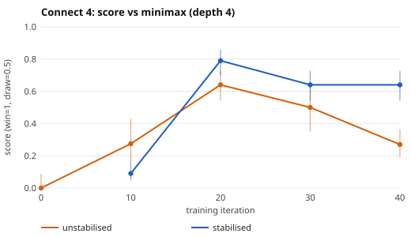
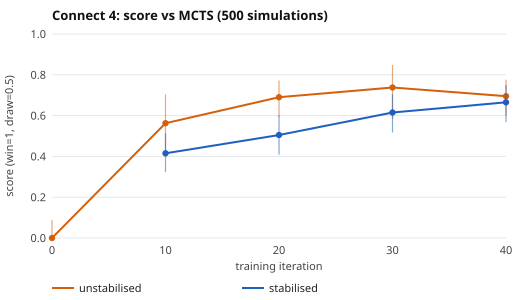
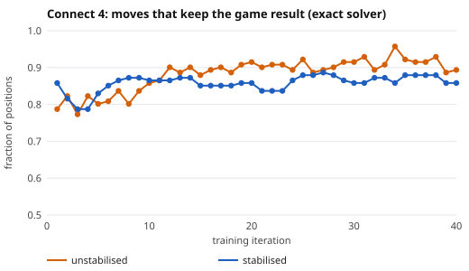
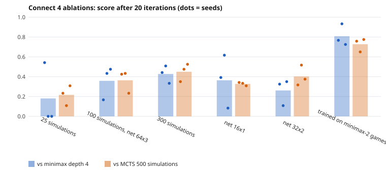
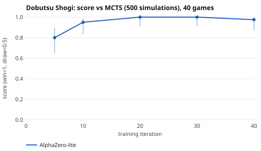

# Self-play board-game AI: Connect 4 and Dobutsu Shogi

A small, from-scratch implementation of the **AlphaZero** idea (neural network + Monte-Carlo tree search,
trained only by playing against itself), written to run on a laptop CPU. One generic engine plays two
games: **Connect 4** (validation game, with an exact solver as ground truth) and **Dobutsu Shogi**
(どうぶつしょうぎ, a 3x4 shogi variant, the main game).

Author: Henry Ba, final-year engineering student at ISEP (Paris). This is my first project on reinforcement
learning and tree search.
Everything below was measured on a MacBook (Apple Silicon, CPU only, no GPU). Numbers are given with 95%
confidence intervals, and the limitations are listed explicitly at the end.

## Results at a glance

| | Opponent | Games | Score of the AI | 95% CI |
|---|---|---|---|---|
| Connect 4 | Minimax, depth 4 | 100 | **64%** (49W 30D 21L) | 54-73% |
| Connect 4 | MCTS, 500 simulations | 100 | **66.5%** (62W 9D 29L) | 57-75% |
| Dobutsu Shogi | MCTS, 500 simulations | 40 | **97.5%** (38W 2D 0L) | 87-100% |
| Dobutsu Shogi | Minimax, depth 6 | 40 | **77.5%** (22W 18D 0L) | 62-88% |
| Dobutsu Shogi | Minimax, depth 8 | 40 | **15%** (0W 12D 28L) | 7-29% |

Score = wins + half of the draws, over all games; the starting player alternates every game. The AI uses
100 MCTS simulations per move; the network has about 230k parameters and was trained for 40 iterations
(about 50 min for Connect 4, about 100 min for Dobutsu Shogi). A network that has not been trained scores 0%
against both Connect 4 references, so the learning is real. Two results temper the claims: the Dobutsu Shogi AI is **not**
better than a depth-8 minimax, and in a short-budget ablation a network trained by *imitating* a depth-2 minimax beat
self-play (see [Ablations](#ablations-connect-4) and [Limitations](#limitations)).

## Quick start

```bash
python3 -m venv .venv && source .venv/bin/activate
pip install --only-binary=:all: -r requirements.txt     # numpy, torch, pytest (pre-built wheels only)
python -m pytest -q                                      # 43 tests

python scripts/demo.py                                   # play Connect 4 vs the AI at http://127.0.0.1:8000
python scripts/play_random.py --human                    # console game vs a random player

# train (checkpoints + logs go to runs/, which is git-ignored)
python scripts/train.py --game connect4 --name stable --iters 40 --games 100 --sims 100 --steps 200
python scripts/train.py --game dobutsu  --name dobutsu_main --iters 40 --games 100 --sims 100 --steps 200 --dirichlet 0.6
# the "unstabilised" Connect 4 baseline used below
python scripts/train.py --name main --iters 40 --games 100 --sims 100 --steps 200 --arena-games 0 --lr-final-frac 1.0 --buffer 30000

# evaluate checkpoints in matches
python scripts/eval_curve.py --game connect4 --run stable --iters 10 20 30 40 --games 100
python scripts/eval_curve.py --game dobutsu --run dobutsu_main --iters 5 10 20 30 40 --games 40 --opponents mcts
python scripts/make_figures.py                           # regenerate docs/img/*.svg
```

Seeds are fixed (`--seed 0`) but I have not checked that runs are bit-for-bit reproducible
(multi-threaded floating point). Trained models are in `models/` (0.9 MB each).

## How it works

**Self-play.** There are no human games. The current network plays full games against itself. Each position
is stored with (a) the move distribution found by the tree search and (b) the final result of the game
seen from that position's player. The network is then trained to predict both, and the improved network
generates the next games.

**Search (MCTS with PUCT).** To pick a move, the program grows a tree of future positions with 100
simulations. Each simulation walks down the tree choosing the move that maximises
`Q + c * P * sqrt(N_parent) / (1 + N)` (average value so far + a bonus for moves the network likes and that
have been tried little), reaches a new position, evaluates it, and sends the value back up the tree
(flipping its sign at each level, since the opponent's gain is my loss). The visit counts at the root are
the search's answer.

**Network.** A small residual CNN (3 blocks, 64 channels) with two heads: a *policy* (probability of each
move, illegal moves masked) and a *value* (expected outcome in [-1, 1]). The policy steers the search
towards plausible moves; the value replaces the random playouts of classical MCTS. In training, the policy
target is the root visit distribution (the search is better than the raw network, so the network learns
from it) and the value target is the game result. Data is augmented with the left-right mirror image.

**Training loop** (`scripts/train.py`): 100 self-play games -> 200 gradient steps (Adam, cosine learning-rate
decay) -> an *arena* of 40 games between the new network and the current best; the new one replaces the best
only if it scores at least 55%. Self-play always uses the best network. Many games are played in parallel
and leaf positions from all trees are evaluated in one batch, which makes CPU training practical.

**Generic engine.** `src/engine/game.py` defines the game interface (legal moves, play, result, render,
and optional network encoding). Minimax, MCTS, AlphaZero, the match runner and the training loop only use
that interface; adding Dobutsu Shogi required no change to them.

## The games

**Connect 4** (7x6): bitboard implementation, same encoding as Pascal Pons' solver.

**Dobutsu Shogi**: 3 columns x 4 rows, invented by the professional shogi player Madoka Kitao. Each side has
a lion (moves 1 square in any direction), a giraffe (1 square orthogonally), an elephant (1 square
diagonally) and a chick (1 square forward) that promotes to a hen (moves like a shogi gold general).
Captured pieces go to the capturer's hand and can be dropped on any empty square instead of moving. The
game is solved: the second player wins with perfect play (Tanaka, 2009).

Sources disagree on a few details. The rule set implemented here (`src/games/dobutsu.py`, tested):

| Point | Choice |
|---|---|
| Promotion | Mandatory: a chick reaching the far row becomes a hen (sources do not say; **my choice**) |
| Drops | No shogi restrictions: two chicks per file, chick drop on the far row (it then cannot move), drop checkmate all allowed; a captured hen returns as a chick |
| Winning | Capture the opponent's lion, or "try": your lion stands on the far row and the opponent cannot capture it at once (if it can, the game goes on) |
| Repetition | Same position three times = draw (also for perpetual check) |
| Length cap | A game longer than 200 plies is declared a draw (**my addition**, keeps self-play finite) |
| No legal move | Cannot happen according to the sources; checked on 3,000 random positions |

The move generator was cross-checked against a second, independently written implementation (C++, in
`tools/dobutsu_solver.cpp`) on 1,500 random positions: identical results.

## Evaluation protocol

- Matches alternate the starting player (the first player has an advantage in Connect 4 and a disadvantage in
  Dobutsu Shogi), with fixed seeds. Score = (wins + 0.5 draws) / games, with a Wilson 95% interval.
- Connect 4 ground truth: the exact solver of Pascal Pons gives the game-theoretic value of every move.
  I report the share of positions where the chosen move is *optimal* (best exact score) and where it
  *keeps the game result* (a won position stays won, a drawn one stays drawn). Positions: 200 random
  positions of 6 to 24 plies, fixed seed (not very representative of real games, 200 gives about +-3 points).

## Results

### Connect 4: reference opponents

| Player | vs random | Optimal move (solver) | Result-keeping move (solver, won/drawn positions) |
|---|---|---|---|
| Random | - | 25.5% | 50.4% |
| Minimax depth 1 / 2 / 4 / 6 | 100% (100 games each) | 74.5 / 83.5 / 87.5 / 84.5% | 87.2 / 90.8 / 91.5 / 89.4% |
| MCTS 100 / 500 / 2000 simulations | 100% (50 games each) | 70.5 / 79.5 / 88.5% | 82.3 / 88.7 / 92.9% |

MCTS without a network is **weaker** than minimax depth 4 in direct matches (score against it, 50 games:
4%, 22%, 34% for 100, 500, 2000 simulations), although its single-move accuracy is similar. Playing a
random opponent is not informative (every reference wins 100%).

### Connect 4: AlphaZero

Final model (iteration 40, stabilised run): 64% against minimax depth 4 and 66.5% against MCTS-500
(table above); 59% optimal moves with the raw network alone and 73.5% with 100-simulation search.

An untrained network loses all of its games against both references. The first training run had **no
stabilisation** (constant learning rate, 30k-position buffer, every new network accepted): it peaked around
iteration 20 and then got worse (27% against minimax at iteration 40). Adding learning-rate decay, a
100k-position buffer and the arena gating fixed the decline (64% at iteration 40). I changed three things at
once, so I cannot say which one mattered.




Vertical bars are 95% intervals; sample sizes are 40 games (early points of the unstabilised run) and 100
games (all others), so the early points are noisier. The exact-solver metric tells a different story from
the matches: it is slightly *higher* for the unstabilised run (about 90% against about 86% result-keeping
moves) and hardly moves after iteration 10. It measures random positions, not strength in play.



### Ablations (Connect 4)

Three questions, each with 3 seeds. To fit the whole grid in a few hours, every run uses a shorter protocol than
the main run above: **20 iterations x 64 games** (instead of 40 x 100), 150 gradient steps per iteration, arena
gating and learning-rate decay as before. Each trained network is then played 60 games against minimax depth 4
and 60 games against MCTS-500 (100 simulations for the AI, alternating starts). Scores are (wins + 0.5 draws) / games;
the table gives the mean over the 3 seeds and the best and worst seed in brackets.

| Configuration | Seeds | vs minimax-4: mean score (per-seed range) | vs MCTS-500: mean score (per-seed range) |
|---|---|---|---|
| 25 simulations | 3 | 0.18 (0.00-0.54) | 0.22 (0.11-0.31) |
| 100 simulations, net 64x3 (reference) | 3 | 0.36 (0.17-0.47) | 0.36 (0.23-0.43) |
| 300 simulations | 3 | 0.43 (0.33-0.51) | 0.45 (0.35-0.53) |
| net 16x1 | 3 | 0.36 (0.08-0.62) | 0.33 (0.31-0.34) |
| net 32x2 | 3 | 0.26 (0.11-0.35) | 0.40 (0.32-0.52) |
| trained on minimax-2 games | 3 | 0.81 (0.72-0.93) | 0.73 (0.65-0.78) |



What can and cannot be concluded:

- **More simulations per move during self-play helps, weakly.** 25 -> 100 -> 300 simulations gives mean scores
  0.18 -> 0.36 -> 0.43 against minimax and 0.22 -> 0.36 -> 0.45 against MCTS. The trend is monotonic but the
  seed-to-seed spread is as large as the gaps (for example 0.00 to 0.54 for 25 simulations), so I read it as
  "probably real, not demonstrated". Training time grows with it (about 11, 24 and 50 minutes per run).
- **Network size: no visible effect** at this budget (0.36, 0.26, 0.36 against minimax for 16x1, 32x2 and
  64x3). The smallest network (about 6.7 minutes per run) is as good as the reference within the noise; a bigger network
  might need more training to pay off, which I did not test.
- **Learning from a fixed opponent beat self-play here.** A network trained by imitation of a depth-2 minimax
  (2,500 games of minimax against itself with 15% random moves, same network, same 3,000 gradient steps) scores
  **0.81 against minimax-4 and 0.73 against MCTS-500, with the three seeds all above 0.65**, versus 0.36 for
  self-play, and it needs about 5 minutes instead of 24. Caveats: the 20-iteration self-play budget is small
  (the longer 40-iteration run reaches 0.64 and 0.67, still below imitation); the teacher is a strong tactical
  player of the same family as one of the evaluation opponents, which favours imitation; and a teacher is not
  available for most problems. The honest summary is that self-play's advantage (no teacher needed, no ceiling at
  the teacher's level) is not shown by these experiments; whether self-play overtakes imitation with much more
  training is untested.

### Dobutsu Shogi

| Checkpoint | vs MCTS-500 (40 games) |
|---|---|
| 0 (untrained, 20 games) | 22.5% |
| 5 | 80% |
| 10 | 95% |
| 20 / 30 | 100% / 100% |
| 40 | 97.5% |



The final network scores 100% (20 games) against minimax depth 3, 77.5% against depth 6 (no loss, 18 draws
in 40 games) and 15% against depth 8 (0 wins, 12 draws, 28 losses). Its level therefore lies between minimax
depths 6 and 8 (with a simple material heuristic). In the 20-game checks the games were varied (14 and 20 distinct games
out of 20) and the AI won with both colours.

## Limitations

- **No exact reference for Dobutsu Shogi.** The game has been solved, but I did not obtain the solution.
  `tools/dobutsu_solver.cpp` (retrograde analysis, my own code) is written and its move generator is
  cross-checked, but the full table did not complete on my machine (about 1.1 GB needed while the laptop
  was out of memory), so the share of perfect moves is not measured and my rule choices are not validated
  against the figures published by Tanaka. The first attempt looped forever on an undersized hash table; it
  now stops with an error message.
- **One training run per configuration (one seed).** Differences between neighbouring checkpoints (for
  instance 79% then 64% against minimax between iterations 20 and 30) are within run-to-run noise. The
  "stabilisation fixes the decline" conclusion rests on one run each.
- **Game counts are small (20-100)** and the games are not independent: the AI is deterministic and the
  references differ only by random tie-breaks, so the stated intervals are probably too narrow.
- **Draws in Dobutsu Shogi** are frequent (about 29% in self-play); I did not check how many come from the
  200-ply cap rather than genuine repetitions.
- **Ablations are small:** 3 seeds, 60 games per seed and opponent, shortened training (20 iterations); the
  spread between seeds is large, so only the self-play versus imitation gap is clearly visible. They were run on
  Connect 4 only, not on Dobutsu Shogi.
- **Not done yet:** a Dobutsu Shogi demo (the demo is Connect 4 only).
- The Connect 4 solver positions are random prefixes, easier than positions from real games.

## Repository layout

```
src/engine/       Game interface, match runner (alternating starts, Wilson interval)
src/games/        connect4.py (bitboards), dobutsu.py, registry.py
src/players/      random, minimax (alpha-beta + transposition table), MCTS (UCT, random playouts)
src/alphazero/    net.py, search.py (batched PUCT), selfplay.py, arena.py
src/solver_ref.py wrapper around the external Connect 4 solver (cached results)
src/demo/         stdlib web server + single-page UI
scripts/          train, train_from_opponent, ablate, evaluation, solver build, figures, demo
tools/            dobutsu_solver.cpp (retrograde analysis, in progress)
docs/             figures (SVG) and the logs behind them (JSONL)
models/           trained Connect 4 and Dobutsu Shogi networks
```

## References and licences

- D. Silver et al., *Mastering Chess and Shogi by Self-Play with a General Reinforcement Learning Algorithm*,
  arXiv:1712.01815 (2017) - the AlphaZero method this project reduces to a laptop scale.
- L. Kocsis, C. Szepesvari, *Bandit based Monte-Carlo Planning* (2006) - UCT.
- P. Pons, *Connect 4 solver*, https://github.com/PascalPons/connect4 (AGPL-3.0). Used **only as an external
  program** for evaluation: it is cloned and built into `external/` by `scripts/build_solver.sh` and none of
  its code is included in this repository.
- T. Tanaka, 田中哲朗, *どうぶつしょうぎ* solution, 2009 (https://ipsj.ixsq.nii.ac.jp/records/62415) - the game is
  a second-player win; its published position counts are the target for validating my solver.
- Dobutsu Shogi rules: [Japanese Wikipedia](https://ja.wikipedia.org/wiki/どうぶつしょうぎ) and
  [English Wikipedia](https://en.wikipedia.org/wiki/D%C5%8Dbutsu_sh%C5%8Dgi). The game was invented by
  Madoka Kitao.

## License

MIT (see `LICENSE`). The external Connect 4 solver is AGPL-3.0 and is not part of this repository.
